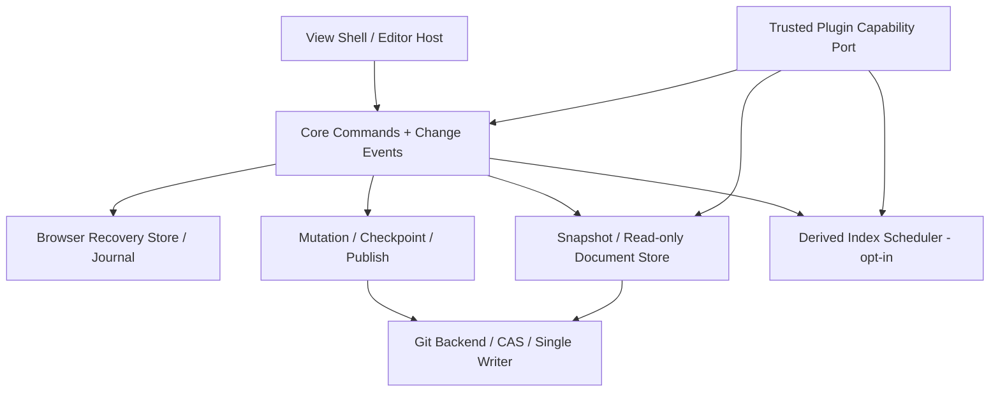

# Scriptorium Core — 全面性能・設計改善候補台帳

- **監査基準:** `yohn-jp/scriptorium` main `546882f05a5f4b4a412e64c7aec868d401ce8ca9` (2026-10-20)
- **対象:** Browser、API、Git/Snapshot、Journal、Workspace、Core extension contract、OCI / build closure。
- **除外:** 個別プラグインの内部機能・アルゴリズム・NLPモデルの採否。Coreの拡張契約とプラグインをロードするホストのコストは対象。
- **性質:** 静的ソースレビュー。実行時レイテンシ、メモリ、アクセス数、CPUの**ベースラインは未計測**。**P0/P1/P2は調査・実験の優先度であり、実測済みの障害等級ではない**。
- **保護条件:** GitHub正本、単一Writer、Generation/Epoch、read-set/CAS、Git publication unknown/conflict、ブラウザの厳密な回復Journal、ホスト認証境界、Symlink安全性は削減のために緩和しない。

## 設計の中心

> インタラクションは編集差分から即時に反応する。Gitはイミュータブルな読み取りを並列実行し、参照更新と保存を厳密に排他する。索引は変更から差分更新し、不必要なプラグインやバックグラウンド通信は動かさない。

実装の現状を無視しない。Coreはすでに `CodeMirror 6`、`SnapshotReader`、Git object batch、immutable hierarchy cache、editorの初期化1回、Browser IndexedDB厳密durability、回数制限つきGit publication、プロファイル別依存削除、Lazy panel mount/AbortController、状態変化SSE を有する。**これらを保持・一般化し、弱い経路だけを取り替える。**

## 改善候補 — コード根拠・検証まで

| 区分 | 優先 | 観測したコード上の構造 | 改善方向（仮説） | 計測項目 | 根拠 |
|---|---|---|---|---|---|
| 編集・描画 | P0 | CodeMirrorのdocChangedで文書全体をtoString()している | CodeMirror ChangeSet・変更rangeを第一級入力にし全文化は保存境界へ | 入力p95/1文字あたりalloc/全文化回数 | [source](https://github.com/yohn-jp/scriptorium/blob/546882f05a5f4b4a412e64c7aec868d401ce8ca9/app/src/editor/ManuscriptInput.tsx#L151-L169) |
| 編集・描画 | P0 | カーソル移動でも全文toString()・文章内文位置の再計算 | 選択周辺のインクリメンタル文区切り索引・行キャッシュを検討 | 矢印キーp95/長文選択p99 | [source](https://github.com/yohn-jp/scriptorium/blob/546882f05a5f4b4a412e64c7aec868d401ce8ca9/app/src/editor/ManuscriptInput.tsx#L151-L169) |
| 編集・描画 | P0 | editTextが毎回完全なChangeOperationを構築・検証 | 入力のHot Pathは差分と変更世代のみ、完全なOperationは復旧永続化前に構築 | 入力p95/操作あたりCPU/GC | [source](https://github.com/yohn-jp/scriptorium/blob/546882f05a5f4b4a412e64c7aec868d401ce8ca9/app/src/application/SharedApplication.tsx#L1574-L1605) |
| 編集・描画 | P0 | 編集ごとにAuthorWorkspace全体のWorkStateをsetState | 文書本文ストア/コマンドストア/レイアウト・サイドバー状態を購読単位で分離 | React Profiler commit/再renderノード | [source](https://github.com/yohn-jp/scriptorium/blob/546882f05a5f4b4a412e64c7aec868d401ce8ca9/app/src/application/SharedApplication.tsx#L383-L478) |
| 編集・描画 | P0 | CodeMirror value同期時の全文比較とフルレンジ置換の可能性 | 外部変更の明示Origin・revisionと最小差分dispatchを設計 | 編集時のCM dispatch bytes/historyの変化 | [source](https://github.com/yohn-jp/scriptorium/blob/546882f05a5f4b4a412e64c7aec868d401ce8ca9/app/src/editor/ManuscriptInput.tsx#L188-L201) |
| 編集・描画 | P1 | 巨大SharedApplicationにログイン/更新/編集/復旧/描画が共存 | 状態所有者を小規模サービス/React selectorごとに分離しレンダリング境界を確保 | per-keystroke flamegraph/コンポーネント再render | [source](https://github.com/yohn-jp/scriptorium/blob/546882f05a5f4b4a412e64c7aec868d401ce8ca9/app/src/application/SharedApplication.tsx#L383-L478) |
| 編集・描画 | P1 | Workspaceへ毎描画で新たなpanel配列・render closureを渡す | PanelCatalogを安定化し表示中のパネルだけ独立購読する | React allocation・panel render-count | [source](https://github.com/yohn-jp/scriptorium/blob/546882f05a5f4b4a412e64c7aec868d401ce8ca9/app/src/application/SharedApplication.tsx#L2404-L2423) |
| 編集・描画 | P1 | Workspaceがpanel prop identityでcatalog/mapを再生成 | Panel ID/catalogを版付き不変レジストリとして保持 | WorkState更新時のlayout計算時間 | [source](https://github.com/yohn-jp/scriptorium/blob/546882f05a5f4b4a412e64c7aec868d401ce8ca9/app/src/workspace/Workspace.tsx#L260-L280) |
| 編集・描画 | P1 | 分割ペインのresizeが全レイアウトの状態更新を起こす | rAFに合わせたresize commit/過剰layoutの抑制 | resize操作のfps/Long Task | [source](https://github.com/yohn-jp/scriptorium/blob/546882f05a5f4b4a412e64c7aec868d401ce8ca9/app/src/workspace/Workspace.tsx#L425-L430) |
| 編集・描画 | P1 | scene切替時にdraft flush→remote/effective fetch→IDB lookupを順に待つ | 未保存保護を崩さず背景prefetchと同一Snapshot cache、表示優先を設計 | scene-to-scene p95とblock内訳 | [source](https://github.com/yohn-jp/scriptorium/blob/546882f05a5f4b4a412e64c7aec868d401ce8ca9/app/src/application/SharedApplication.tsx#L870-L964) |
| 編集・描画 | P2 | シーン/読書/スクラッチ/履歴が単一Editor画面のpropsを拡大 | 可視状態に応じたサブツリー分離・必要時コード読み込み | 初期JS量/マウントCPU | [source](https://github.com/yohn-jp/scriptorium/blob/546882f05a5f4b4a412e64c7aec868d401ce8ca9/app/src/editor/SceneEditor.tsx#L48-L145) |
| ブラウザ回復 | P0 | 350ms autosaveが厳密IndexedDBトランザクションを使用 | 安全なバッチ化・差分記録を比較。厳密永続性と障害復旧を維持 | typing burstあたりfsync相当/IDB readwrite数 | [source](https://github.com/yohn-jp/scriptorium/blob/546882f05a5f4b4a412e64c7aec868d401ce8ca9/app/src/application/SharedApplication.tsx#L1574-L1605) |
| ブラウザ回復 | P0 | autosaveのたびにrefreshJournalが全entries/proposalsを取得 | 変更されたdocumentKeyだけ反映するイベント/ビューを検討 | IDB getAll件数・転送bytes・UI再render | [source](https://github.com/yohn-jp/scriptorium/blob/546882f05a5f4b4a412e64c7aec868d401ce8ca9/app/src/application/SharedApplication.tsx#L1519-L1553) |
| ブラウザ回復 | P0 | JournalEntryはtext、baseText、operation.writes.contentの全文を重複保持 | 復旧可能性を維持する不変本文＋content hash/deltaの正規化形式を検討 | draft 1件当たり保存Bytes/復旧レイテンシ | [source](https://github.com/yohn-jp/scriptorium/blob/546882f05a5f4b4a412e64c7aec868d401ce8ca9/app/src/application/SharedApplication.tsx#L186-L267) |
| ブラウザ回復 | P1 | putLatestDraftがdocumentKeyで全件取得し全文JSONで世代を比較 | key/世代インデックスと不可変digestで対象レコードのみ更新 | 100/1k draftでの保存p95・IDB read件数 | [source](https://github.com/yohn-jp/scriptorium/blob/546882f05a5f4b4a412e64c7aec868d401ce8ca9/app/src/storage/journal.ts#L219-L285) |
| ブラウザ回復 | P1 | getAllEntries/getAllProposalsが全Repository情報を全走査 | repositoryKey/authorScopeで部分検索し後方互換な移行を設計 | 全体Journal増大時の起動時間・ピークメモリ | [source](https://github.com/yohn-jp/scriptorium/blob/546882f05a5f4b4a412e64c7aec868d401ce8ca9/app/src/storage/journal.ts#L284-L326) |
| ブラウザ回復 | P1 | ドラフトの書込キューは単一で、移動・復旧待ちが長くなり得る | 書込順序保証の単位をauthor+repo+documentにして妥当性検証 | 入力直後の保存待ちp95・タブ閉鎖損失 | [source](https://github.com/yohn-jp/scriptorium/blob/546882f05a5f4b4a412e64c7aec868d401ce8ca9/app/src/application/SharedApplication.tsx#L1519-L1553) |
| ブラウザ回復 | P1 | ブラウザとローカルGitの二つの永続化段階がある | Draft→Checkpoint→Publishの状態機械・receiptを型とイベントで単一化 | 回復テストとネット断時の不確定状態率 | [source](https://github.com/yohn-jp/scriptorium/blob/546882f05a5f4b4a412e64c7aec868d401ce8ca9/app/src/storage/journal.ts#L19-L71) |
| ブラウザ回復 | P2 | ページ離脱で未完了保存をbest-effort起動 | pagehideで同期保証をせず、保護済み状態の区別をUI/ログで可視化 | 強制終了で復元できた操作率 | [source](https://github.com/yohn-jp/scriptorium/blob/546882f05a5f4b4a412e64c7aec868d401ce8ca9/app/src/application/SharedApplication.tsx#L1378-L1392) |
| Git・Snapshot | P0 | readTree/reader/search等もmutation file lockを取得 | commitで固定した不変Snapshot読取を並行化。mutable ref/GC/破壊的操作は排他を維持 | 重い同期中のread p95・lock待ち時間 | [source](https://github.com/yohn-jp/scriptorium/blob/546882f05a5f4b4a412e64c7aec868d401ce8ca9/packages/core/src/index.ts#L4348-L4424) |
| Git・Snapshot | P0 | snapshotFileのパス階層ごとにgit ls-tree subprocessを起動 | 検証済みtree object indexかbatched tree walkを共通read pathへ適用 | Git起動数/ファイル切替p95 | [source](https://github.com/yohn-jp/scriptorium/blob/546882f05a5f4b4a412e64c7aec868d401ce8ca9/packages/core/src/index.ts#L1442-L1485) |
| Git・Snapshot | P0 | snapshotFileRevisionsが変更なしでも全ls-treeと未cached blobごとのcat-fileを実行 | tree OID利用・差分revision cache・cat-file batchに集約 | 10k/100kファイルのlistRevisions時間・process数 | [source](https://github.com/yohn-jp/scriptorium/blob/546882f05a5f4b4a412e64c7aec868d401ce8ca9/packages/core/src/index.ts#L1502-L1538) |
| Git・Snapshot | P0 | createCommitがファイルごとにtreeEntry・hash-object・update-indexを実行 | 安全な一括hash/index更新、原子的commitとCASを保つ | 100ファイル変更のfork/exec回数・commit p95 | [source](https://github.com/yohn-jp/scriptorium/blob/546882f05a5f4b4a412e64c7aec868d401ce8ca9/packages/core/src/index.ts#L1633-L1679) |
| Git・Snapshot | P1 | CoreStoreがGit/Registry/Proposal/Sync/History/Lockを一つに持つ | ProjectRegistry、ImmutableSnapshotStore、MutationTransaction、GitTransport、PublicationServiceへ責務分割 | 性能計測点の粒度・テスト分離容易性 | [source](https://github.com/yohn-jp/scriptorium/blob/546882f05a5f4b4a412e64c7aec868d401ce8ca9/packages/core/src/index.ts#L1059-L1118) |
| Git・Snapshot | P1 | getProjectが呼び出しごとにJSON registryをFSから読む | プロセス内immutable registry cacheと更新時/外部改変時の整合プロトコル | fs read count、lookup p95 | [source](https://github.com/yohn-jp/scriptorium/blob/546882f05a5f4b4a412e64c7aec868d401ce8ca9/packages/core/src/index.ts#L1124-L1185) |
| Git・Snapshot | P1 | selectedSnapshotでobservation/reconcile/ref参照が重複する場合がある | request-scoped pinned snapshot contextを再利用、参照整合を再検証 | API requestあたりGit subprocess/DB操作 | [source](https://github.com/yohn-jp/scriptorium/blob/546882f05a5f4b4a412e64c7aec868d401ce8ca9/packages/core/src/index.ts#L2358-L2382) |
| Git・Snapshot | P1 | localDurabilityCensusがrev-list --all --reflog・status・履歴検証を行う | 整合性を証明できる補助索引/イベントトレースの可能性検証 | 長い履歴でcensus p95・安全性同等性 | [source](https://github.com/yohn-jp/scriptorium/blob/546882f05a5f4b4a412e64c7aec868d401ce8ca9/packages/core/src/index.ts#L2507-L2597) |
| Git・Snapshot | P1 | publishでreconcile・history・local operation scanを複数回行う | 不変commitの読取をmemo化、stateful CAS/競合retryは維持 | publish p95と同じcommitへの重複照会 | [source](https://github.com/yohn-jp/scriptorium/blob/546882f05a5f4b4a412e64c7aec868d401ce8ca9/packages/core/src/index.ts#L3943-L4037) |
| Git・Snapshot | P1 | status()が毎回fetchRemoteを呼ぶ | 表示用のlocal statusと明示的remote refreshを区別 | status APIネットワークbytes/p95 | [source](https://github.com/yohn-jp/scriptorium/blob/546882f05a5f4b4a412e64c7aec868d401ce8ca9/packages/core/src/index.ts#L5025-L5051) |
| Git・Snapshot | P2 | git execFile上限32MBが大きなBinary/Treeに合わない場合がある | バイナリはbounded stream/個別Blob APIで分離、無制限Buffer化をしない | large assetのpeak RSSと失敗コード | [source](https://github.com/yohn-jp/scriptorium/blob/546882f05a5f4b4a412e64c7aec868d401ce8ca9/packages/core/src/index.ts#L845-L945) |
| Git・Snapshot | P2 | fileRevisionCache 16,384件/hierarchy cache16MB/history cache64MBを別々に管理 | repo単位の予算・LRU・idle解放・圧力下の計測を導入 | server RSS/heap/cache hit/eviction | [source](https://github.com/yohn-jp/scriptorium/blob/546882f05a5f4b4a412e64c7aec868d401ce8ca9/packages/core/src/index.ts#L1068-L1086) |
| 索引・情報 | P0 | Core searchSnapshotがHierarchy/Sceneを全走査し本文を順次読む | 小規模scan fallbackと変更連動の再構築可能な索引を分ける | ファイル数Nに対する検索時間の傾き | [source](https://github.com/yohn-jp/scriptorium/blob/546882f05a5f4b4a412e64c7aec868d401ce8ca9/packages/core/src/index.ts#L2890-L3015) |
| 索引・情報 | P0 | writingStatsSnapshotが毎回シーンを全走査して本文を読む | Git Blob ID→メトリクス導出キャッシュ、changed-only集計 | 1k/10k/100k文件で集計p95 | [source](https://github.com/yohn-jp/scriptorium/blob/546882f05a5f4b4a412e64c7aec868d401ce8ca9/packages/core/src/index.ts#L3016-L3115) |
| 索引・情報 | P0 | hierarchySnapshotがvolume→chapter loopsでfiles.flatMap/filterを反復 | 1回のtree walkからparent→child mapを構築しO(N)に近づける | CPU/file sizeスケーリング係数 | [source](https://github.com/yohn-jp/scriptorium/blob/546882f05a5f4b4a412e64c7aec868d401ce8ca9/packages/core/src/index.ts#L2611-L2699) |
| 索引・情報 | P1 | readHierarchyYamlには既にbounded cat-file batchとrevision cacheがある | この成功したパターンを汎用File/Snapshot読取へ水平展開 | Git subprocess削減率と実メモリ | [source](https://github.com/yohn-jp/scriptorium/blob/546882f05a5f4b4a412e64c7aec868d401ce8ca9/packages/core/src/index.ts#L2700-L2792) |
| 索引・情報 | P1 | 複数の派生機能で同じ文件を個別に走査する余地 | ファイル変更の共通イベント＋コンテンツHashから派生計算を再利用 | 同一変更の複数機能の総CPU/読み込み | [source](https://github.com/yohn-jp/scriptorium/blob/546882f05a5f4b4a412e64c7aec868d401ce8ca9/packages/contracts/src/index.ts#L84-L99) |
| 索引・情報 | P2 | ファイル階層はvolume/chapter/sceneに強く結合している | 既存レイアウトを残し、一般ファイル階層をCoreで第一級サポート | Markdown以外を含むRepoでの一覧/検索正確性 | [source](https://github.com/yohn-jp/scriptorium/blob/546882f05a5f4b4a412e64c7aec868d401ce8ca9/packages/core/src/index.ts#L2611-L2699) |
| API・通信 | P0 | Remote観測を表示中15秒間隔でGET | remote change通知/条件付き取得/focus照合/指数間隔を比較 | UI開きっぱなしのrequest/h、検知遅延 | [source](https://github.com/yohn-jp/scriptorium/blob/546882f05a5f4b4a412e64c7aec868d401ce8ca9/app/src/application/SharedApplication.tsx#L1286-L1376) |
| API・通信 | P0 | Recent Activityも15秒間隔GET、hidden除外なし | hiddenタブ停止、意味ある変化のみ再読込、SSE/visibility復帰時照合 | hidden/visibleのrequest/h | [source](https://github.com/yohn-jp/scriptorium/blob/546882f05a5f4b4a412e64c7aec868d401ce8ca9/app/src/resume/useRecentActivityResume.ts#L122-L179) |
| API・通信 | P0 | カーソル移動後2秒でPUT recent activity | 位置の変化・送信粒度・last-write-winsを最小化、複数端末規約維持 | sessionあたりPUT回数・同期遅延 | [source](https://github.com/yohn-jp/scriptorium/blob/546882f05a5f4b4a412e64c7aec868d401ce8ca9/app/src/resume/useRecentActivityResume.ts#L189-L228) |
| API・通信 | P0 | /api/platform/v1/statusでremote modeの場合2度GitHub observe、persistence scanを実行 | live activity fast pathとauthoritative persistence censusを分離、証拠の鮮度保証 | k3s probeあたりGitHub呼び出し/3.5s timeout率 | [source](https://github.com/yohn-jp/scriptorium/blob/546882f05a5f4b4a412e64c7aec868d401ce8ca9/packages/api/src/server.ts#L1153-L1235) |
| API・通信 | P1 | Server recent-activity upsertが全state read/modify/fsync/rename/dir sync | 同等の耐久性を持つ小規模append/event log、SQLite等は実測後に判断 | 1 PUTあたりIO・fsync・RSS | [source](https://github.com/yohn-jp/scriptorium/blob/546882f05a5f4b4a412e64c7aec868d401ce8ca9/packages/api/src/recent-activity-store.ts#L93-L132) |
| API・通信 | P1 | Coreには既にproject/events SSEが存在しクライアントは購読していない | 既存イベントを調査してまずlocal changeに利用、GitHub外部更新は別途照合 | poll削減・SSE常時接続コスト | [source](https://github.com/yohn-jp/scriptorium/blob/546882f05a5f4b4a412e64c7aec868d401ce8ca9/packages/api/src/server.ts#L1610-L1619) |
| API・通信 | P1 | /api/version→session→projects→details→tree のbootstrapウォーターフォール | 1回のauth bootstrap/read snapshot集約、バンドル過大化は回避 | TTI p95/RTT回数・不要な再検証有無 | [source](https://github.com/yohn-jp/scriptorium/blob/546882f05a5f4b4a412e64c7aec868d401ce8ca9/app/src/application/SharedApplication.tsx#L682-L765) |
| API・通信 | P1 | FastifyだがrouteHandlerが巨大な1ファイルに集中 | HTTPルートを権限/契約単位で分離、ルーティング/エラー境界を固定 | 1要求あたりCPU・変更回帰率・import graph | [source](https://github.com/yohn-jp/scriptorium/blob/546882f05a5f4b4a412e64c7aec868d401ce8ca9/packages/api/src/server.ts#L1450-L2240) |
| API・通信 | P1 | 静的ファイルGETで毎回realpath/lstat/readFileしている | 起動時に固定asset manifest検証、immutable fingerprint assetに正しいキャッシュヘッダ | GETあたりfs syscalls・TTFB・cache hit | [source](https://github.com/yohn-jp/scriptorium/blob/546882f05a5f4b4a412e64c7aec868d401ce8ca9/packages/api/src/server.ts#L292-L374) |
| API・通信 | P1 | Assetのエントリ名main.js/styles.cssはURLが固定である | content-hash付静的assetとmanifestによるversioned response/CDN cache | 2回目ロードの転送bytes | [source](https://github.com/yohn-jp/scriptorium/blob/546882f05a5f4b4a412e64c7aec868d401ce8ca9/app/vite.config.ts#L1-L117) |
| API・通信 | P2 | HTTP JSONが12MiB上限でbase64ファイルを含む | 大容量データをstreaming blob accessに切離し、上限とトークン範囲を守る | 画像/添付保存のピークRSS・転送bytes | [source](https://github.com/yohn-jp/scriptorium/blob/546882f05a5f4b4a412e64c7aec868d401ce8ca9/packages/api/src/server.ts#L47-L55) |
| API・通信 | P2 | APIにはjob SSEとproject SSEの二系統が存在 | 単一イベントEnvelope/再接続cursor/バックプレッシャを検討 | SSE接続数・replay率・メモリ | [source](https://github.com/yohn-jp/scriptorium/blob/546882f05a5f4b4a412e64c7aec868d401ce8ca9/packages/api/src/server.ts#L1610-L1645) |
| 拡張・能力境界 | P0 | Scene/Manuscript中心の操作型がCore全体を規定 | Git Workspace Files/Snapshot/MutationをCore契約、執筆を上位Domain Adapterに整理 | Core単独で.md以外の任意ファイル一覧/読書/保存 | [source](https://github.com/yohn-jp/scriptorium/blob/546882f05a5f4b4a412e64c7aec868d401ce8ca9/packages/contracts/src/index.ts#L46-L64) |
| 拡張・能力境界 | P0 | Mutationを単なるファイルwriteに落とすとWriter安全性を失う | Snapshot+read set+write set+expected revision+receiptの汎用mutation能力を固定 | content conflict/old writer/unknown publishの耐障害試験 | [source](https://github.com/yohn-jp/scriptorium/blob/546882f05a5f4b4a412e64c7aec868d401ce8ca9/packages/contracts/src/index.ts#L49-L108) |
| 拡張・能力境界 | P0 | 有効/無効機能はコンパイルprofileで分離済 | profileでdisabledのコード・import・timer・network・worker・UI contributionが0を不変条件化 | core buildのimport closure/CPU idle | [source](https://github.com/yohn-jp/scriptorium/blob/546882f05a5f4b4a412e64c7aec868d401ce8ca9/scripts/profile-build.mjs#L10-L58) |
| 拡張・能力境界 | P1 | ModuleIdとbuild generatorが9種をハードコード | 製品登録manifest生成を採用、権限/署名/allowlist/bundleを静的に検証 | module追加時のCore変更ファイル数 | [source](https://github.com/yohn-jp/scriptorium/blob/546882f05a5f4b4a412e64c7aec868d401ce8ca9/packages/contracts/src/index.ts#L1-L7) |
| 拡張・能力境界 | P1 | SnapshotReaderはread/list/listRevisionsのみ | bounded paging, batched read, revision/events, binary streamをcapabilityとして設計 | 10k files read RPC数、plugin一回のfetch数 | [source](https://github.com/yohn-jp/scriptorium/blob/546882f05a5f4b4a412e64c7aec868d401ce8ca9/packages/contracts/src/index.ts#L84-L99) |
| 拡張・能力境界 | P1 | BrowserのPanelContributionはlazy mount + AbortController実装済 | stable capabilitiesとdisposeを基盤化し、UI以外から編集状態を勝手に取得しない | disable後CPU/timer/worker count 0 | [source](https://github.com/yohn-jp/scriptorium/blob/546882f05a5f4b4a412e64c7aec868d401ce8ca9/app/src/contributions/ContributionHost.tsx#L94-L174) |
| 拡張・能力境界 | P1 | Coreローカルファイル操作を外部機能に無制限に公開しない契約がある | permission-scoped read/compute/proposeを明確なセキュリティ層として保つ | 異Repo読取/任意FS触りの拒否試験 | [source](https://github.com/yohn-jp/scriptorium/blob/546882f05a5f4b4a412e64c7aec868d401ce8ca9/packages/contracts/src/index.ts#L177-L194) |
| 拡張・能力境界 | P2 | Binary画像はChangeOperationのbase64 contentに入り得る | 小さな添付と大容量Blobを区別しストリーミング・content hash導入を検討 | 添付10MBの転送/CPU/保存失敗率 | [source](https://github.com/yohn-jp/scriptorium/blob/546882f05a5f4b4a412e64c7aec868d401ce8ca9/packages/contracts/src/index.ts#L46-L52) |
| 配信・起動 | P0 | 起動時のJS量・Core-only RSS/CPU計測の自動回帰が見当たらない | シナリオ固定のBrowser/Node/OCI benchmark harnessと予算導入 | JS gzip、TTI、RSS、CPU、fork count | [source](https://github.com/yohn-jp/scriptorium/blob/546882f05a5f4b4a412e64c7aec868d401ce8ca9/scripts/audit-runtime-deps.mjs#L1-L127) |
| 配信・起動 | P1 | Viteはlauncher / desktop / mobileを独立buildするがlauncherでAppを静的import | ランチャーだけの配信サイズと不要コードclosureを分離して計測 | 初期JS gzip/3画面別初期描画時間 | [source](https://github.com/yohn-jp/scriptorium/blob/546882f05a5f4b4a412e64c7aec868d401ce8ca9/app/src/main.tsx#L1-L12) |
| 配信・起動 | P1 | Vite cssCodeSplitがfalse | CSSをcore above-foldとoptional viewに分割した場合を計測 | 初期CSS bytesとstyle recalc | [source](https://github.com/yohn-jp/scriptorium/blob/546882f05a5f4b4a412e64c7aec868d401ce8ca9/app/vite.config.ts#L1-L117) |
| 配信・起動 | P1 | root pnpm buildがCore profileでも全moduleをbuild | 開発/test/build時間とプロダクションclosureを分けたCore専用ビルドグラフ | core-only clean build s/CI node-min | [source](https://github.com/yohn-jp/scriptorium/blob/546882f05a5f4b4a412e64c7aec868d401ce8ca9/package.json#L1-L38) |
| 配信・起動 | P1 | Dockerfile runtimeはnode:24 slim+git+tiniで複数段OCIを使用 | 実RSS/起動time/レイヤサイズ/idleファイル数を測定、削るのは安全性と検証後 | cold start p95/RSS / image bytes | [source](https://github.com/yohn-jp/scriptorium/blob/546882f05a5f4b4a412e64c7aec868d401ce8ca9/Dockerfile#L55-L93) |
| 配信・起動 | P2 | 各CoreStore cacheが独立上限・全体制限なし | pressure-aware shared memory budgetとidleness eviction | 100k repo時RSS max/CPU idle | [source](https://github.com/yohn-jp/scriptorium/blob/546882f05a5f4b4a412e64c7aec868d401ce8ca9/packages/core/src/index.ts#L1069-L1086) |
| 配信・起動 | P2 | エラー/ログと性能トレースが共通のrequest IDで統合されていない可能性 | Git/FS/IDB/HTTP/React/CMを一つのtrace連結で計測する設計 | p95 latency attribution coverage | [source](https://github.com/yohn-jp/scriptorium/blob/546882f05a5f4b4a412e64c7aec868d401ce8ca9/packages/api/src/server.ts#L483-L561) |
## 互いに競合する最適化を避ける

- **ロックを除去しない:** immutable commitを参照する読み取りは安全を検証して並列化するが、Project Registryの更新、HEAD/Ref・indexの変更、Checkpoint/PublishのCAS、外部プロセスの単一Writer排他は維持する。旧Repoやsymlinkによる越境対策も残す。
- **「Git Blob OID＝仕様上のFileRevision」と直ちに同一視しない:** 既存のrevisionForBytesはSHA-256等のContractに結び付いている。安価な検証に置換できるかはテスト・段階移行を伴う。
- **Autosave削減がデータロスにならない:** strict IndexedDB記録がないDraftは保存済みと表示しない。Journal圧縮・差分化はkill -9/Tab crash/QuotaExceeded/multiple tab replayの検証後。
- **通知がGitHubの正本にはならない:** GitHub外部からのpushやWebhook欠落を考え、イベント後にも必要な観測/一致照合を残す。15秒タイマーを無条件に消すのではなく、検知SLAとネットワークコストを比較。
- **Core-onlyは本当に小さいこと:** build profileで不要コードを除くことと、process heap/CPUが増えないことは別。静的closure検査＋実測memory/idle timer検査を両立。
- **将来の一般ファイル機能でScriptoriumの既存文書形式を破壊しない:** volume/chapter/sceneとGit metadataは既存adapterとして残し、generic file workspace capabilityを基底として拡張。

## 優先して設計すべきCore 6境界（提案）

1. **Editor/Interaction:** CodeMirror transactions to typed resource-scoped events; no root React state updates on each keypress; avoid cross-panel rerender.
2. **Browser Durability:** Journal states and receipts remain exact; debounce/batching without silently claiming a save; cross-tab collision proof.
3. **Immutable Snapshot:** Pinned `(repository, remoteCommit, overlayCommit)` read context, bounded tree/object reads, true read/write distinction; important CAS/fence on mutations.
4. **Git Mutation/Sync:** Trusted single writer, operation receipts, reference generation fence, safe batch subprocess/stream, GitHub remote verification.
5. **Index/Data Views:** Reconstructible per-snapshot file tree + content hash; derived search, backlink or document metadata consumers subscribe only to diffs, optional heavier workers activate lazily.
6. **Host + Extension:** Trusted/allowlisted manifest/capabilities; disabled means zero imported optional code, timers, network handlers, heavyweight resident caches, and worker children. Activation and suspension/cleanup are observable.

## 性能実験の最小ルール

**現行の数字を捏造しない。** 改善前の `main` と候補ブランチを同一ハードウェア/Node/Chrome/WebKit/データセットで比較。平均だけでなく p50/p95/p99、heap peak、fork/exec回数、file system reads、request/h、更新イベント回数を記録。

固定テストデータを最低4段階で用意する: (A) 10 files/short docs、(B) 1,000 files/large chapters、(C) 10,000 files/10MB attachments、(D) 100,000 files/long Git history; 書き込み・同時保存/ネット分断/途中クラッシュ・unknown publication・多数タブも別の負荷シナリオ。特に入力は1KB・100KB・1MBの文書、英日IME、コピペ、undo/redo、画面切替を測る。

| ワークロード | 観測対象 | 完了判定例（数値はBaseline後決定） |
|---|---|---|
| キー入力/スクロール | JS flamegraph、Long Tasks、React commits、CodeMirror dispatch | 入力p95は1frame内、バックグラウンドの全索引更新をHot Pathに入れない |
| ファイル切替 | Critical Path breakdown、Git process count、Journal待ち | 変更なしのSnapshot読みをキャッシュして不要Git起動を抑える |
| 検索/統計 | ファイル数とp95の関数、索引作成/差分更新 | Index構築以降の通常検索は全ファイル再走査を避ける |
| Idle 24h | Network calls/h、Node idle CPU/RSS、browser timers | アイドル時外部ポーリングと不要ワーカーを最小にし、鮮度を保証 |
| 大量ファイルGit | cat-file/ls-tree/update-index subprocess、syscalls、RSS | O(file count)を超える不必要な反復を排除 |
| 障害・回復 | Journal durability、remote CAS、unknown publish、Writer排他 | 同等以上のfail-closed動作、未公開作業を失わない |

## 推奨する実行順序（実装はこの監査の範囲外）

- **Wave 0:** 精密なトレースと固定データセット。Page load, typing, Git read, journal write, server status, idle probesのBaselineを固定。
- **Wave 1:** キー入力の全文化・上位React更新・Journal全件再取得・15秒の二重定期通信（特にhidden）に手を入れる。各々の効果を独立測定。
- **Wave 2:** immutable Snapshotのread/write分離、汎用Git batch、treeのO(N)索引化、scan検索・統計の実測比較。
- **Wave 3:** CoreをFile/Document/Mutationの薄い境界として再構成、HTTP routing/asset配信とtrusted plugin capabilityの分離を実施。互換Adapterが旧scene契約を満たす。
- **Wave 4:** Browser/Node/OCIの予算をCI/Release gate化。対象コンテナの実際のRSSと起動時間、Runtimeが無操作時に発生させる通信とプローブを含めて継続監視。

**文書の位置づけ:** 2026-10-20の静的ソース監査に基づく改善候補。実測ベースライン・性能向上の証明・実装変更・本番適用は含まない。