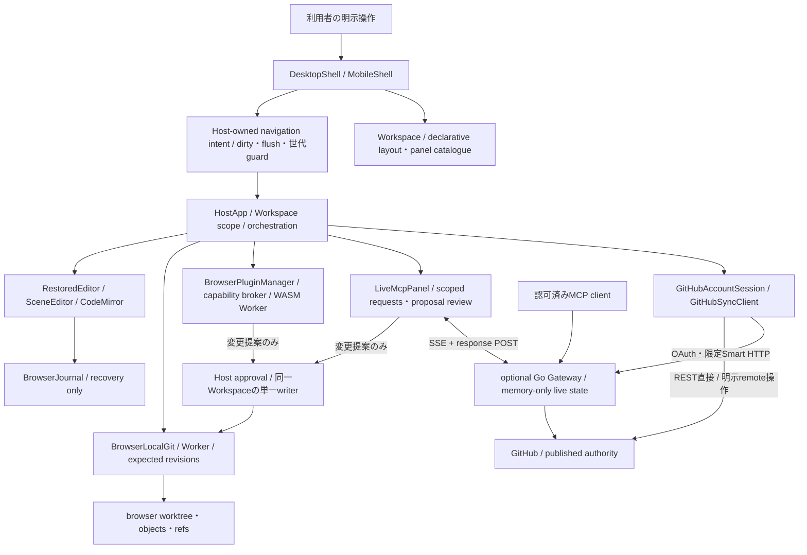

# Proprium UI・導線アーキテクチャ

**Status: normative design contract.** UIの実装変更や公開環境の動作証明ではない。[機能・画面台帳](SCREEN-CATALOG.md)が到達可能な実装と不足を区別し、[全遷移図](USER-FLOWS.md)が操作・成功・拒否・復旧経路を定める。本書はそれらを支える状態、認証、責務、受入条件の正本である。

## 1. 設計の固定点

Propriumはgeneric Git filesを扱うbrowser-native workspaceである。ローカル編集・local Git・検証済みcached WASM利用にGateway、GitHubログイン、外部modelを要求しない。GitHubは公開済みデータの正本であり、browser journal、worktree、local commitをremote保存と呼ばない。

Desktop/Mobileの既存shell、CodeMirror、読書・組版、dock/split/floating、retained editor/toolsを再利用する。旧Node application controller、Hosted/OCI、常設Workspace backendを復活させない。見た目を全面置換することもこの設計の目的ではない。

初回開始・認証・repository選択は編集用sidebarとは異なるタスクである。Desktopでは主領域、Mobileでは全幅のタスク面に置く。Workspace選択後は既存の多ペイン構成／mobile task navigationへ移る。Home、設定、認証面を整理するためにeditorやplugin/MCP runtimeを複製しない。

### 文書の責務

| 文書 | 正本とする内容 |
| --- | --- |
| [Overview](OVERVIEW.md) | 製品境界・依存方向・データ所有者 |
| [Workspace UX](WORKSPACE-UX.md) | 編集継続性・端末別操作・表示の基本原則 |
| [Screen catalogue](SCREEN-CATALOG.md) | 機能、画面ID、実装への接続、未整備導線 |
| [User flows](USER-FLOWS.md) | 利用者操作と遷移・中止・再試行・戻り先 |
| 本書 | 画面を支える状態・責務・認可・受入条件 |
| [Git/storage](GIT-AND-STORAGE.md)、[Plugin platform](PLUGIN-PLATFORM.md)、[MCP](MCP-GATEWAY.md) | 各ドメインのmutation、revision、capability、transport契約 |
| [Gateway operations](../deployment/GATEWAY.md) | 実在するCLI、設定、配布・運用手順 |

画面IDは論理識別子であり、新規URL・API・CLIの実装宣言ではない。画面だけを追加してドメインのguardを弱めない。ソース実装の到達点と目標設計を混ぜず、後続の実装差分に応じて台帳を更新する。

## 2. 機能の所有者と実装境界

この図のnavigation intentとHost approvalは論理責務であり、新しい汎用frameworkや別runtimeの導入要求ではない。既存`beforeLayoutChange`、`requestedPanel`、世代検証、Git adapterを利用する。pluginとMCPが別のreview表示を持っていても、revision検証とHost-owned writeという契約は同じである。

| 層 | 保有する状態／許される処理 | 保有しない権限 |
| --- | --- | --- |
| Shell / Workspace | view、panel配置、focus、scroll、戻り先、非秘密の設定 | token発行、Git commit/push、plugin実行の独立所有 |
| Host orchestration | active Workspace、file、操作intent、GitHub session参照、明示的な効果の開始 | 古い画面の応答で別Workspaceを変更する権限 |
| Editor / journal | 入力、selection、IME、undo、回復記録、表示設定 | GitHub保存完了の独自判定 |
| Browser Git / sync | revision付き読書き、local commit、remote比較、非force公開、確認 | 無承認の内容消去／force push |
| Plugin manager / broker | verified artifact、workspace grants、実行lease、derived result | Git認証情報・Host DOM・無制限filesystem・独立publication |
| Live bridge / Gateway | scoped client、session generation、deadline、request correlation | 永続Workspace、server-side Git、owner承認を省略した適用 |

UI構成変更は表示の所有権を変えるだけである。panelを非表示にしてもeditor入力、undo、active plugin、Live接続を終了しない。Workspace変更／明示Stop・Disable／session失効では、対応する実行・認可を無効化する。二重mountや見えない別の接続を作らない。

## 3. 状態を独立した軸として扱う

一つの`busy`、`connected`、`saved`で全機能の状態を表さない。以下は論理モデルであり、型名や既存stateの一括書換えを要求しない。

| 軸 | 区別する状態 | 表示・操作の帰結 |
| --- | --- | --- |
| navigation | Home / task / Workspace / dialog / sheet、復帰先 | URLやpanel selectionだけで認証済みにならない |
| editor buffer | clean / dirty / IME中 | 最新の未保存入力を古いasync結果で置換しない |
| recovery journal | pending / recorded / unavailable / failed | recordedはworktree保存・commit・publishではない |
| local Git | no commit / worktree changed / clean at OID / storage unknown | 不確実なobject/ref整合性を検証するまで成功扱いしない |
| remote sync | disconnected / idle / fetching / pulling / publishing / local-ahead / conflict / remote-unknown / confirmed | confirmedは対象revisionとremoteを示す。次の編集を保存済みと誤認させない |
| GitHub auth | absent / device pending / authenticated / expired / denied | remote要求だけを制限。local作業をログインで塞がない |
| Live MCP | disabled / connecting / connected / disconnected / error | GitHub authとは独立。再起動後はfresh sessionと再認可 |
| plugin | not installed / installed-disabled / enabled-idle / active / failed / revoked | install、権限同意、実行を分ける。停止とpanel非表示を分ける |
| layout/preferences | unsaved / saved / invalid / unavailable | 保存失敗を文書消失に結び付けず、入力を維持する |

すべての非同期効果は必要なWorkspace ID、generation、file revision、operation ID、キャンセル信号を持つ。画面を切り替えても結果の帰属は変えない。同一Workspaceのmutationは既存writer経由で直列化し、提案に含まれるread/write setを適用直前に検証する。

### ローカル開始とremote binding

H02はHostのpickerから接続済みである。利用者が名前を入力すると、Hostは`provider: "local"`、`branch: "main"`、一意な`localWorkspaceId`を持つlocal identityを作り、BrowserLocalGitを開く。新規Workspaceは空で、文書作成は別のファイル操作である。local identityはGitHubのrepository IDを偽装せず、WorkspaceのGitデータと履歴はこのブラウザーに保存される。

remoteを結び付ける際はH03でrepository ID、branch、本人権限と既存local内容を確認する。bindingなしではlocal commitは可能、remote fetch/publishは利用できない。local Workspaceの作成はremote bindingを行わない。新規GitHub repository作成、branch CRUD、強制上書きは本設計で追加しない。

## 4. 遷移の共通プロトコル

遷移は「発火元と行先の捕捉 → 必要な入力flush／回復確認 → dirty離脱の判断 → 最新intent・scopeの再確認 → 表示切替 → focus／戻り先復元」とする。flushが失敗した場合は入力を残し、その画面で再試行できるようにする。古い非同期確認が、新しい戻る操作や別Workspaceへの移動を後から覆さない。

ファイル／Workspaceを離れるときは、保存して進む、明示的に破棄、留まるを区別する。保存に失敗しても破棄扱いで進まない。配置のresizeなど文書を離れない操作で不要な保存を強制せず、再parent・mode変更・文書切替に必要なguardを既存境界へ置く。Homeロゴ、ブラウザーBack/Forward、mobile footer、sheetを閉じる操作も意図を区別する。

認証中止はpollingと後続応答の採用を止め、秘密を残さず元のタスクへ戻す。認証成功は操作可能性を回復するだけで、保留していたPublish・提案適用を自動実行しない。UI mode変更やtheme変更はlocal commitや権限付与を生まない。

同じ面を再度開く場合も、一覧選択、入力、未完了理由を可能な範囲で保持する。tokenや認可codeをURL・history state・localStorageに入れて復元しない。再読込で復元できる非秘密設定と、再認証が必要なメモリ状態を明示する。

## 5. 認証・認可と入口の信頼境界

Gateway公開経路はCloudflare Accessを唯一のネットワーク認証境界とし、Proprium独自のOwner Key、MCP Client Token、クライアントペアリング、capability公開選択を要求しない。Tunnelの転送先GatewayはLoopbackにのみbindし、直接公開しない。Origin/Host/CORS検証は維持するが、これ自体をネットワーク認証と呼ばない。Cloudflare Access未保護の別公開経路を追加してはならない。

| 経路 | 検証主体 | 保持する権限・状態 |
| --- | --- | --- |
| 静的Hostとローカル編集 | ブラウザー内の保存領域 | ログイン不要、変更内容はローカルに保存 |
| 公開Gatewayへのアクセス | Cloudflare Access | 許可されたIdentityのみ。Managed OAuthはMCPクライアント用 |
| GitHub Device OAuthとAPI・Smart HTTP | GitHub OAuthとGatewayの既存Repository ID・permission検証 | GitHub TokenはBrowser Hostのメモリのみ |
| Live Browser Host登録・SSE・結果返却 | Access、厳密なHost/Origin、ランダムなセッションID・generation照合 | Gatewayの揮発メモリ。Owner Keyや永続Tokenを発行しない |
| MCPツール一覧 | Gateway | 8ツールを接続状態と無関係に常時公開 |
| MCPツール呼出し | Access、現在アクティブなBrowser Host、明示repository_id | 対象Repositoryのローカル権限と実データはBrowser Hostが管理 |
| ファイル変更提案 | Browser Hostの明示承認とrevision再照合 | ローカルworktree変更のみ。commit/publishは別操作 |

複数Browser Hostが接続した場合は、フォーカス・可視状態に基づく明示activationで操作先を切り替える。アクティブHostが切断したら古いHostへ自動でfailoverしない。Clientごとのツール公開状態、Owner Key、Owner TokenをUI・秘密設定・URL・ログに残さない。

Gateway URLを変更すると既存Live接続を終了し、新しいGatewayへ再登録する。GitHubの認証とGatewayのアクセス認証は別目的であり、GitHub TokenをMCPアクセス認証に流用しない。MCP要求をGitHubへの自動Publishや提案の自動適用へ昇格させない。

## 6. 利用者権限でのGateway導入・運用

Linux amd64/arm64の標準管理導線は[Gateway operations](../deployment/GATEWAY.md)に記載した`proprium` CLIである。`install`、`setup`、`start`、`stop`、`restart`、`status`、`update`、`rollback`、`logs`、`doctor`、`version`、`help`を提供し、Gatewayとpinned `cloudflared`の別々の実行ファイルを一つのsystemd user serviceで管理する。Gateway executableにTunnelを埋め込む契約ではない。検証済みreleaseはmain push後に自動公開される。

### 配布と更新

CLIはGitHub Releases APIからGateway releaseを選び、同一release ID/tagのLinux bundleと`SHA256SUMS`を取得する。APIが示すbundleのSHA-256 digest、release checksum、embedded archive manifest、各component hashを照合する。checksumはbyte整合性の検査であり、単独でpublisher認証を証明するものではない。リリース切替前の検証が失敗した場合は現行ファイルを維持し、起動・health checkに失敗した場合は直前の既知正常バージョンへ復旧する。

更新は明示操作とする。`stop`、`restart`、`update`、`rollback`はGatewayのprivate local control socketでLive MCP状態を確認する。active connectionがあれば、対話操作はsession終了の明示確認を求め、非対話操作はserviceを変更せず失敗する。`--maintenance`は明示的にsession終了を許可する。受理された更新／rollbackはGatewayを再起動して既存Live sessionを切断する。以前のsession、client grant、未確定mutationを復元または再送しない。

### OS権限と常駐

| 操作 | 通常ユーザーで扱う範囲 | 別途確認が必要な境界 |
| --- | --- | --- |
| 配置・設定 | XDG user pathsの`bin`、`config/proprium`、`data/proprium` | 他ユーザーのファイル、system directoryを上書きしない |
| Gateway listen | loopbackの非特権port。public URLとHost originを照合 | wildcard listenは明示判断。HTTPS公開経路と一致させる |
| cloudflared | CLIがpinned binaryを配置・更新し、Gatewayと同じuser serviceで起動／停止 | Tunnel作成・DNS routeはCloudflare account権限。OS rootとは別 |
| 常駐 | systemd user serviceとuser journal | user manager、logout/boot時の継続可否 |
| logout後の稼働 | hostが許可するuser-service/linger policyに従う | [loginctlのlinger](https://www.freedesktop.org/software/systemd/man/devel/loginctl.html)設定には環境の認可が必要。実行可能とは推定しない |
| 更新・復旧 | CLIによるuser-owned asset切替とuser service再起動 | system-wide service installやroot取得を必須にしない |

管理対象のassetやservice metadataを手動で置換・削除しない。`status`、`logs`、`doctor`はローカルプロセスと疎通を診断するが、public HTTPS、OAuth、SSE経路の運用検証の代替にはならない。CLI managementはLinux amd64/arm64を対象とし、Windows/macOSでは未対応である。Gateway runtime archiveの公開はCLI service管理の対応を意味しない。

local/publicの`/healthz`成功だけを認証・MCP利用成功としない。OAuth、Host/Origin検証、SSE streaming、認可済みread、拒否される無認可要求、切断後の再認可をそれぞれ検証する。静的Host、Gateway、plugin artifactの更新・障害を一つの「接続済み」にまとめない。

## 7. 表示・アクセシビリティ契約

ライト、ダーク、紙の全themeで本文・label・code・error・disabled状態の役割が読めること。通常文字は[WCAGの最低contrast](https://www.w3.org/WAI/WCAG22/Understanding/contrast-minimum.html)4.5:1、大きな文字は3:1を基準とする。認証code、承認link、状態、操作buttonを別領域にし、重ね書き・極端な低contrast・status shelfだけの必須操作を禁止する。

操作名と保存範囲を日本語UI内で一貫させる。「この端末へ保存」「ローカルcommit」「GitHubへ公開」「結果未確認」を区別する。既存のCheckpoint／Save to GitHub表記を残す場合も同じ意味に対応させる。色、icon、tooltipだけに依存しない。errorには失敗した機能、保持されるデータ、利用可能な次の操作を示す。

Desktopはkeyboardと同時閲覧、Mobileは単一タスク、thumb操作、IME・virtual keyboard、参照sheetを優先する。画面幅だけで能力を断定せず、明示mode選択を維持する。[focusが隠れないこと](https://www.w3.org/WAI/WCAG22/Understanding/focus-not-obscured-minimum.html)、dialog/sheetのfocus管理、閉じた後の発火元復帰、Back/Forward、読書中の位置を確認する。gestureには操作button等の代替を用意する。

## 8. 後続実装の受入条件

台帳・図・以下の条件を一緒に満たす。存在しない導線をソースに追加しただけ、buildが通っただけでは画面の受入完了としない。Desktop ChromiumとMobile WebKit相当のブラウザー操作、必要な実機・公開経路の検証を区別する。

| 対象機能 | 受入に必要な操作・失敗時確認 | 図 |
| --- | --- | --- |
| FT01–02 | Gateway/loginなしの初回local開始、再訪、cold offlineとの差、evicted保存領域の説明 | F01 |
| FT03–04 | codeの判読とcopy/link、popup不可、pending/slow_down、拒否/期限/中止、別account、repo0件、permission/branchエラー | F02–03 |
| FT05–06 | local start/reopen、text/binary、新規path・移動・削除、file/ZIP取込と書出しの上限・上書き確認・dirty guard、現在の文書と保存済みZIPの内容差、dirty離脱の3選択、IME中/遅延読込、journalとworktree保存失敗で入力を保持 | F01, F04, F16 |
| FT07–09 | 読書/preview/縦横/集中/印刷/組版、scratch画像拒否・中止・回復・local checkpoint。本文と無関係な削除をしない | F05–06 |
| FT10–12 | 全変更pathのdiff確認gateと一括local commit、author、履歴一覧/diff、revision guard付き変更file restoreと未対応path/mode、fetch不変、pull/local-ahead/conflict、publish exact SHA、失われた応答の再照合、無断再送なし | F07–08 |
| FT13–15 | signed preview同意前に大容量転送しない、disabled install、権限拒否、run/stop、stale result、update失敗・rollback・uninstall、proposal拒否/競合 | F09–10 |
| FT16–17 | Live自動登録と再接続、固定8ツールの切断時表示、repository_id選択・未知ID拒否、active Host切替・切断時fail-closed、deadline、提案の明示承認、Owner Key/Client Token UI不在 | F11–12 |
| FT18–20 | panel移動/float/closeでeditor/plugin/MCPを重複・終了しない、layout保存失敗、mode切替、全theme、Mobile5view/back/sheet/keyboard | F13–15 |
| FT21 | shell外から到達できるstorage verification、失敗時markerとbytes保持、journal再試行・回復、削除を復旧に代用しない | F16 |
| FT22 | clean user領域にlatest導入、OS/arch・release一致、不正checksum拒否、foreground/user-service分岐、公開SSE確認、更新失敗復帰 | F17 |

未接続の汎用機能、placeholder、test-only入口を受入証拠に数えない。runtime未変更の文書PRではリンク・ID・図・ドメイン整合を検証し、browser/Tunnel/認証の実動作は未検証として報告する。
