# Proprium 全機能の画面遷移

**Status: normative interaction contract, except F00 which maps the connected source surfaces.** [画面台帳](SCREEN-CATALOG.md)のIDを使う。F01以降は不足部分を含めた目標契約であり、存在しないボタン/APIを実装済みとは扱わない。[UIアーキテクチャ](UI-ARCHITECTURE.md)が状態と認可の所有者を定める。

矢印は「利用者操作／結果／guard」を表す。画面遷移だけではcommit、publish、権限付与、再送を起こさない。X04は呼出元に紐付く失敗状態であり、editorを置き換える万能error pageではない。成功・空・拒否・中止・失敗を同一のspinnerに潰さない。

## F00 — 接続済みソースの画面構成

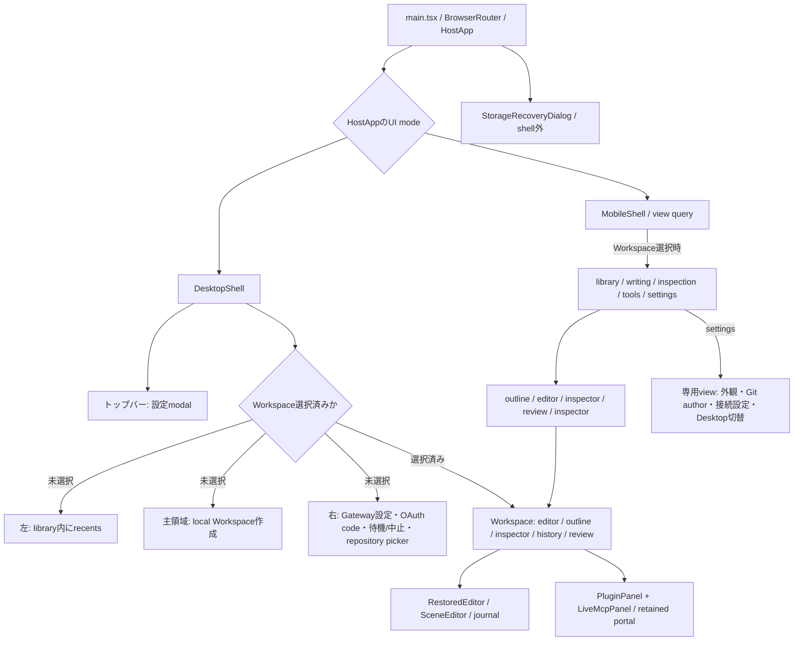

Desktopの設定contentはトップバーから開くmodal、MobileはWorkspace navigation内の`view=settings`専用viewである。上図は表示の正常性ではなく接続関係である。local startもpickerから利用できる。認証の期限／再試行／復帰先を揃える部分などは引き続き目標契約である。

## F01 — 起動・ローカル開始・再訪

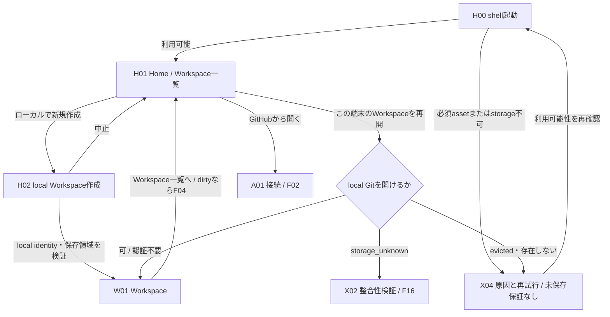

H02の作成とlocal再開はpickerから接続済みである。作成されるのはbrowser storageに保存する空のgeneric local Git Workspaceで、文書は別に作成する。これはnovel structureを認識したりWriter pluginを実装したりするものではない。remote identityを捏造せず、cached shell/local dataがないcold offlineと、既存Workspaceのoffline再開を分ける。GitHubからの再取得で未公開localデータが戻るとは説明しない。

## F02 — Gateway選択とGitHub Device OAuth

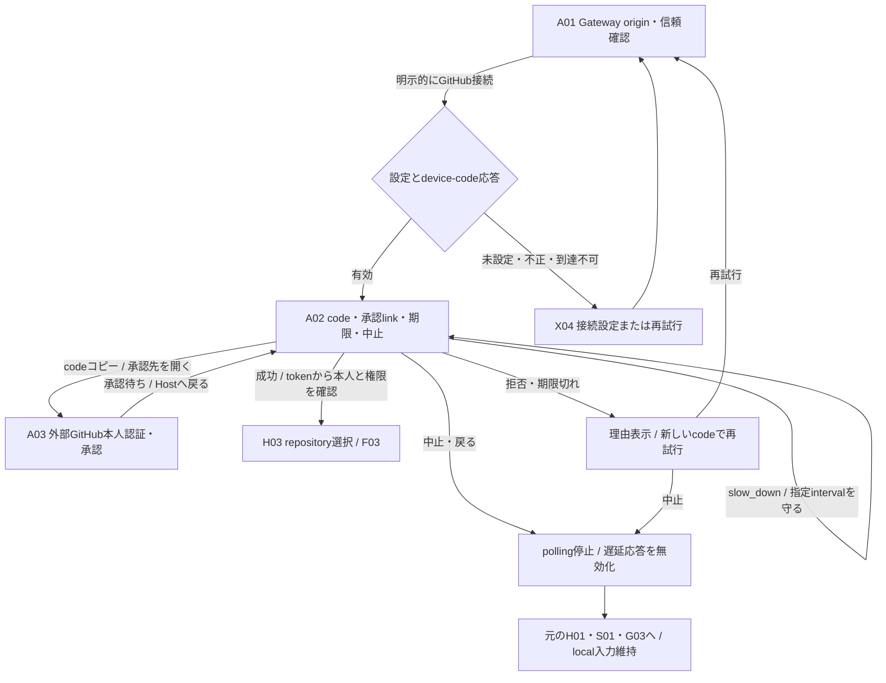

code、外部承認link、残り時間、状態、キャンセルを別の読み取れる領域に置く。popupがブロックされても通常linkとcopyで進める。Device Flowの期限付きpollingは[GitHub仕様](https://docs.github.com/en/apps/oauth-apps/building-oauth-apps/authorizing-oauth-apps#device-flow)に従う。これはMCPや通常画面の定期pollingを許可するものではない。完了時に元の要求へ戻っても、publishを自動実行しない。

## F03 — repository・branch・Workspace選択

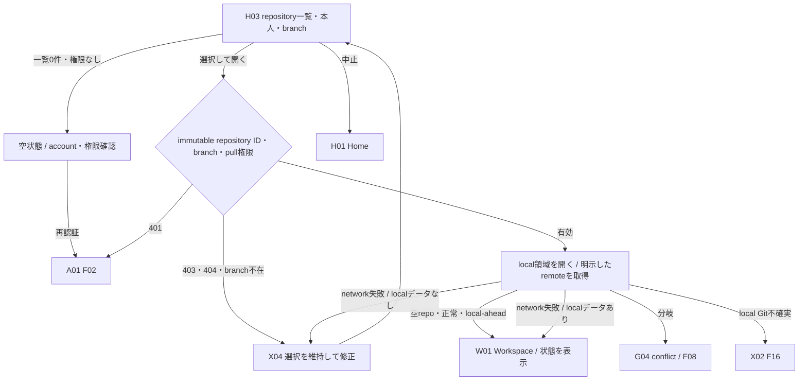

local-only Workspaceをremoteへ結び付ける場合も選択されたID/branchと既存local内容を明示し、同意とrevision検証を行う。既存の別Workspaceを暗黙に上書きしない。bindingが未成立ならremote操作は利用不可と理由を示す。新規repository作成やbranch管理をこの選択画面に捏造しない。

## F04 — ファイル操作・編集・離脱guard

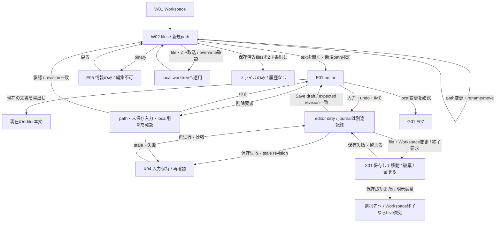

local startとgeneric file browserの作成・削除・path変更・import/exportは接続済みである。個別文書の書出しは現在のeditor本文を使い、ZIP書出しは保存済みworktreeのみを含み、Git履歴・未保存textを含まない。取込は最大256 files、展開後64 MiB、ZIP 68 MiBまでで、既存pathの置換前に確認する。これらはlocal worktree操作で、共有反映にはcommitとpublishが必要。非同期処理中にさらに入力されたtextも保持する。レイアウト変更・mode変更は本文の破棄ではなくjournal flushで扱う（F13/F14）。

## F05 — 読書・preview・組版・印刷

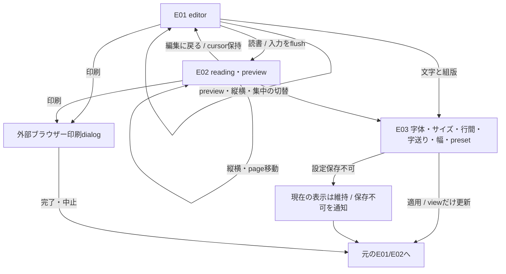

入力補助は選択位置へ文字を挿入する編集操作。組版・印刷はGit commit/publishではない。集中解除、keyboard操作、読書pageの往復で文書・選択・IMEを取り違えない。

## F06 — スクラッチ・添付・回復

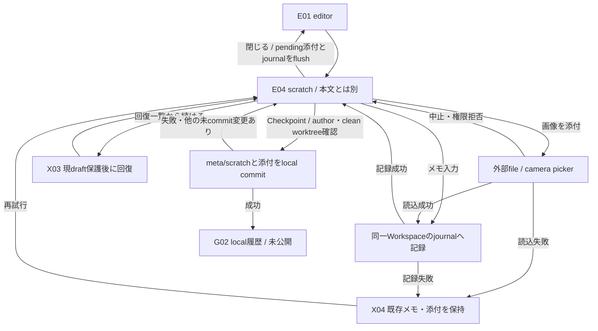

スクラッチCheckpoint成功は本文の保存やGitHub公開を意味しない。失敗したdraftを消さない。回復候補を開くだけでremoteを上書きしない。

## F07 — 変更確認・local commit・履歴

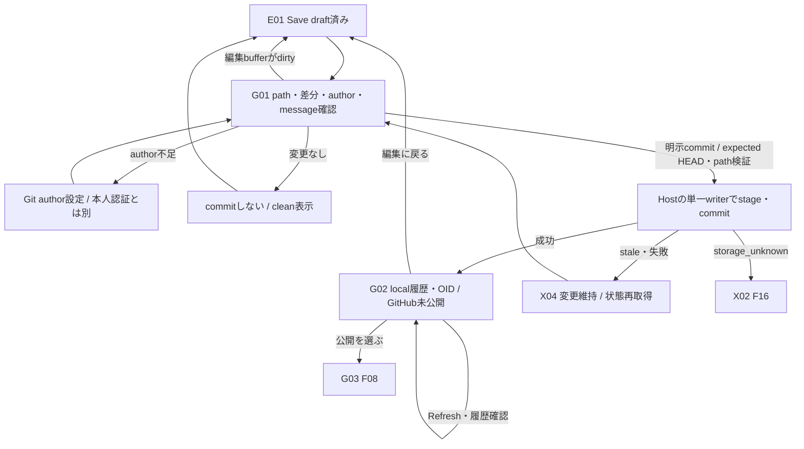

G01ではlocal HEADとの差分を確認できる。text diffを表示し、binaryはbyte sizeのみを示す。commitを有効にするにはすべての変更pathを確認し、実行時には全変更pathをまとめてstageしてlocal commitする。G02には直近40件の履歴、選択commitのdiff、対象commitで変更されたfileだけをlocal worktreeへ戻す操作が接続されている。restoreは確認とrevision guardを通し、commit/publishしない。path衝突・symlink・実行mode変更を含むcommitはrestoreできない。rebase/mergeや履歴改変は提供しない。Checkpointはlocal commitと同義にし、独立した保存機構を増やさない。

## F08 — Fetch・Pull・Publish・conflict・remote-unknown

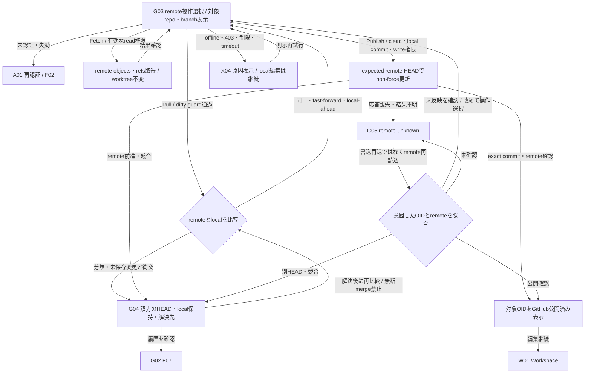

Fetch/Pullの失敗もX04へ戻す。Pushの結果が曖昧ならX04の汎用再試行で書込を再送せずG05へ送る。認証復帰・接続回復だけではPublishしない。現在のadapterが提供しない競合解決アルゴリズムをUIが代行せず、履歴・revision確認と明示的な解決先を提供する。

## F09 — プラグイン導入・更新・実行・停止

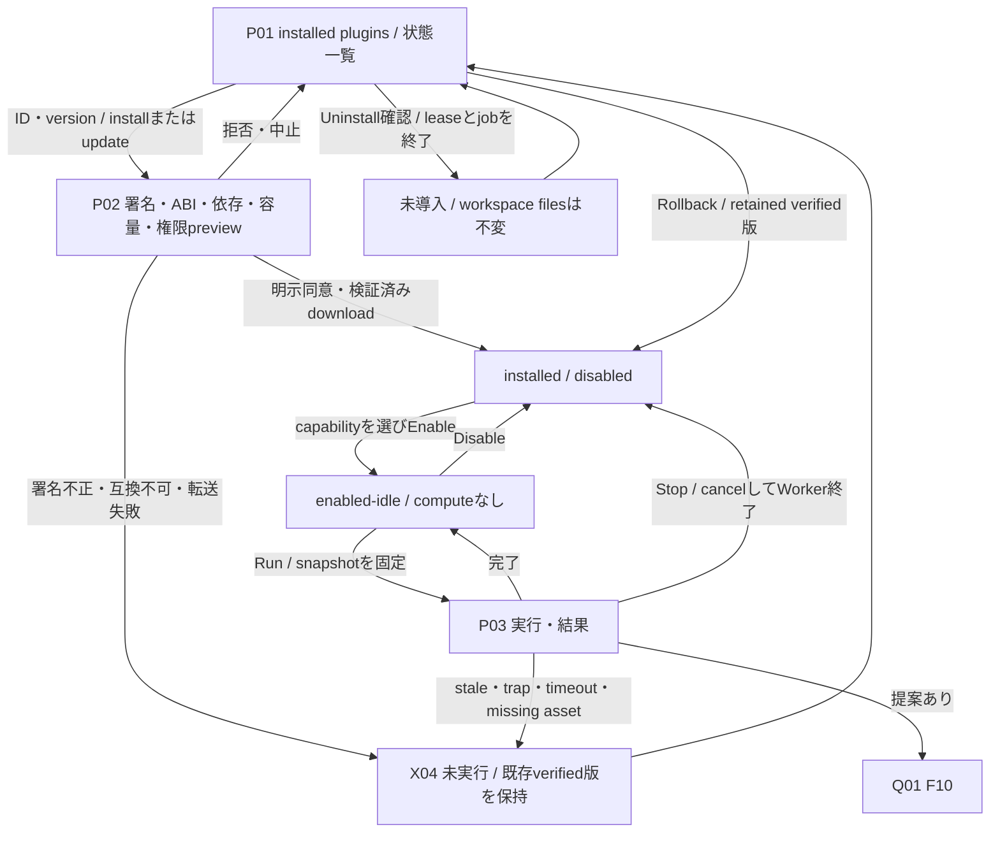

導入と有効化は別。update後の追加権限は再同意する。cached verified bytesが不足するoffline実行は利用不可と表示し、編集は止めない。source上のStopボタンの存在を、全実行状態でキャンセル可能な証明にはしない。P03は検証済みHost-rendered contributionのみを表示する。

## F10 — plugin／MCP提案の共通review

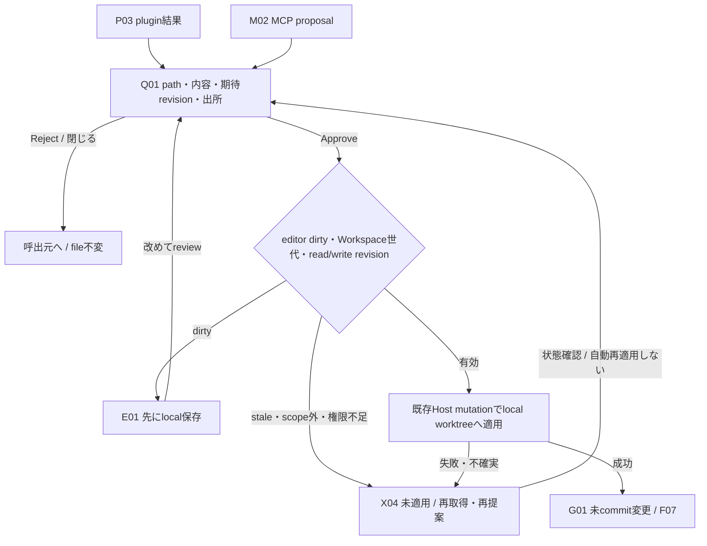

閉じるだけでRejectと扱わず、未処理提案を保持する。承認はcommit/publishの許可ではない。previewの切り詰め表示だけで全変更を承認させず、完全な対象と差分へ到達できること。切断した外部要求を再接続後に自動replayしない。

## F11 — Active Browser HostへのMCP中継

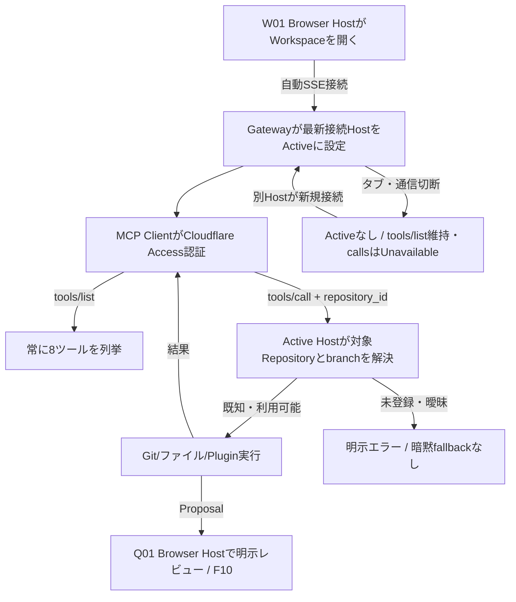

Gatewayはリポジトリを保持せず、同時に複数のBrowser Hostが接続していても最初の接続を初期Activeとし、以後はフォーカスされたBrowser Hostが明示的にActiveを引き継ぐ。Active切断後は古い接続へ暗黙の切替をしない。ユーザーのOwner Key、個別MCP Client Token、クライアント権限・ツール公開選択UIは存在しない。

## F12 — repository_id付きMCP呼出し

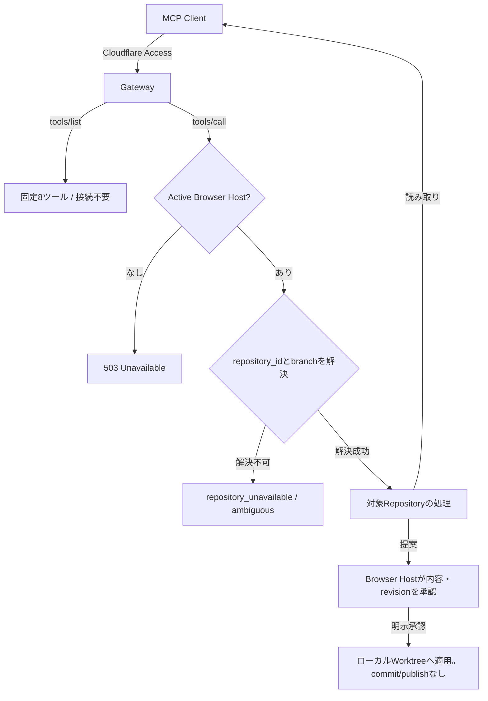

`repositories_list` は引数なしでローカル既知リポジトリを列挙する。それ以外のツールはimmutable `repository_id` を必須とし、複数branchがある場合は `branch` を要求する。未アクティブRepositoryのPlugin呼出しは明示エラーとする。GitHub OAuthの有無や公開GitHub HEADはローカルWorktreeの黙示的な切替を許可しない。ブラウザーが閉じれば実行できないが、ツール一覧は一定とする。

## F13 — Desktop配置・panelの生存期間

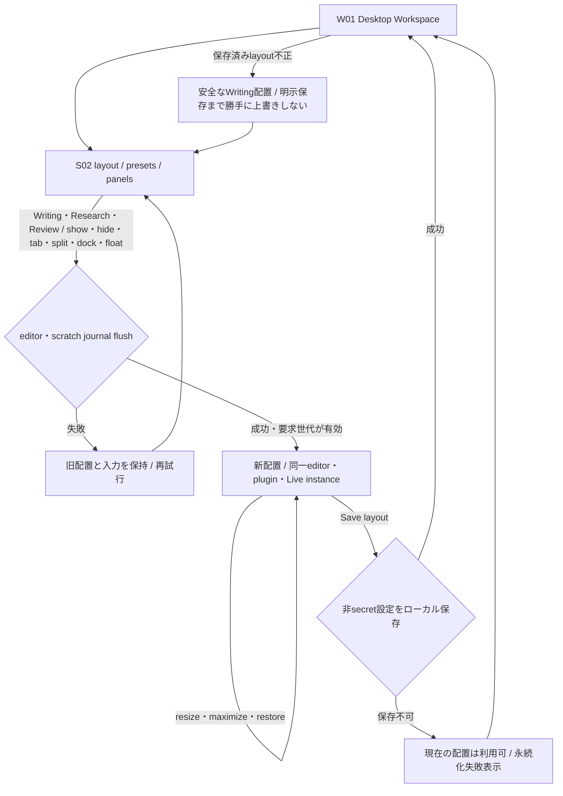

drag以外のMove panelフォーム、keyboardによるtab/resize、hidden panel再表示を維持する。最後の必要な面を閉じて操作不能にしない。layout保存はGitHub保存ではない。

## F14 — Mobile navigation・sheet・mode切替

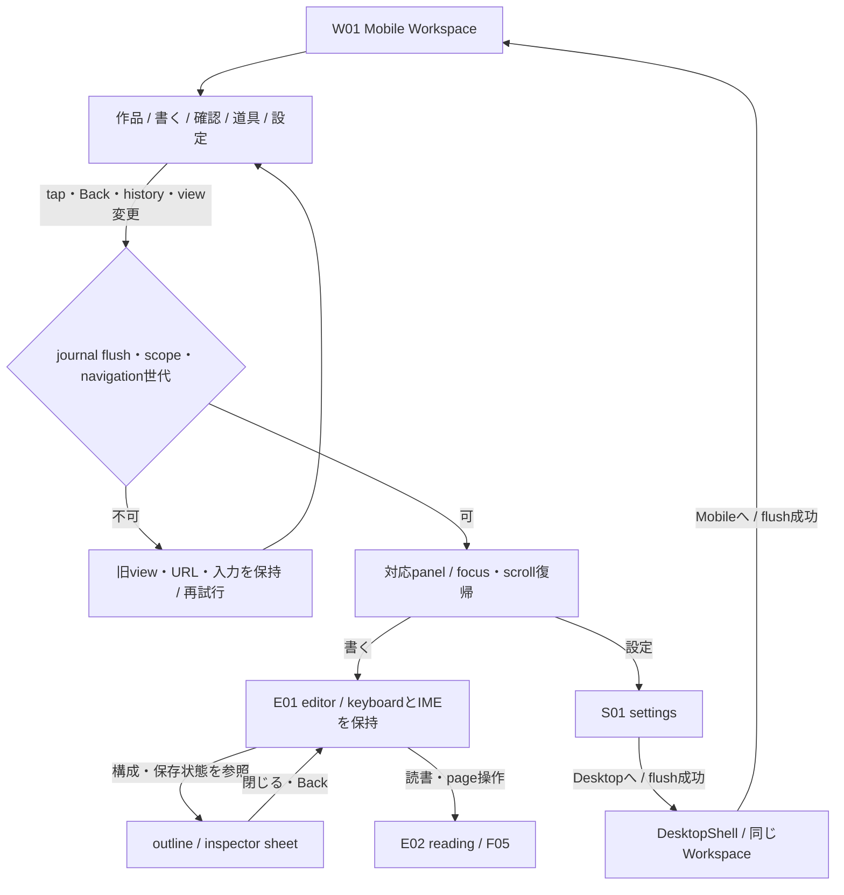

sheetのdismissでtriggerへfocusを戻す。keyboard表示・safe area・orientationで主操作を隠さない。幅が変わるだけでeditorを作り直さない。Workspace未選択時はH01へ誘導し、使えない空panelを主操作にしない。モード切替は明示選択を尊重する。

## F15 — 設定・account・接続先変更

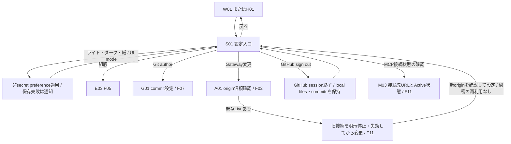

現在、設定contentはDesktopではトップバーから開くmodal、MobileではWorkspace navigation内の専用settings viewに表示され、Desktop切替も含む。外観、Git author、GitHub接続状態、Gateway URLとAccess linkを扱う。shell headerにもthemeとGitHub connect/sign-out操作があるため、全設定をまとめたDesktop settings pageではない。Proprium MCP認証TokenやOwner Keyは発行も保存もしない。GitHub OAuth Tokenは既存どおりブラウザー内で保持し、MCP認証には使わない。Gateway接続先変更時は新Originへの接続を再確立する。

## F16 — 不確実な保存・journal回復・機能別error

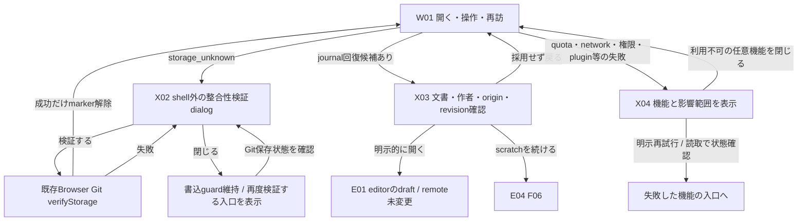

markerを消すためのresetやデータ削除は禁止。回復不能なevictionでは未公開データを救出済みと称さない。ブロッキングerrorを高さ制限のあるstatus shelf内だけに置かない。X04のretryはmutationの無条件再実行ではない。

## F17 — Gateway設置者・Linux CLI・統合user service・更新

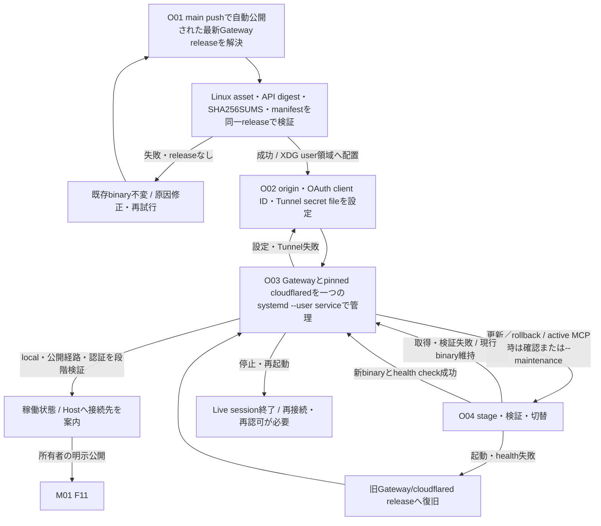

Linux amd64/arm64の`proprium` CLIがlatestのGateway releaseを選択し、pinned `cloudflared`とともにuser領域へ配置して、両者を一つのsystemd user serviceで管理する。main push後にrelease workflowが検証済み資材を自動公開する。非対話設定はsecret fileをデータとして読む。Cloudflare TunnelやDNSの作成は行わない。active MCP connectionがあると通常操作は拒否され、対話では確認し、非対話では失敗する。`--maintenance`は明示的にsessionを終了させてservice変更を許可する。再起動後のsession・認可・未確定mutationは復元しない。継続的な自動更新・再起動を無断で有効にしない。詳細は[UIアーキテクチャ](UI-ARCHITECTURE.md)と[Gateway operations](../deployment/GATEWAY.md)を参照する。
